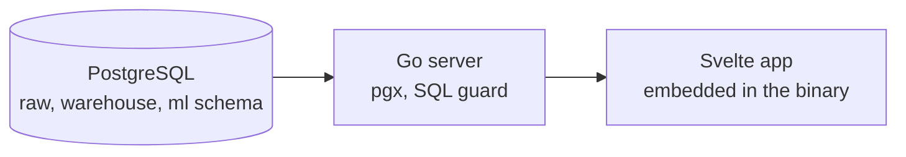

# hst-bi-poc

A self-built, read-only business intelligence dashboard for the [HST synthetic dataset](https://github.com/samsmon/hst-synthetic-dataset) (v0.3.0, 10.8 million ticket records). It has dashboards, a SQL console limited to `SELECT`, and pages for machine learning forecasts.

Status: phase P4 (first screens). The server queries PostgreSQL as a read-only role through a YAML semantic model and a guarded SQL console. The web app has Overview and SQL console pages using real data. Not done yet: global filters, the other dashboard pages, forecasts, authentication.

## Architecture



| Part | Path | Notes |
|---|---|---|
| Server | `server/` | Go. `internal/sqlguard` validates console SQL with the PostgreSQL parser (`pg_query_go`, needs cgo). `internal/api` holds routes. `internal/webui` embeds the built web app. |
| Web | `web/` | Svelte 5, Vite, TypeScript. Charts are hand-drawn SVG so far; uPlot, GSAP and CodeMirror come with the forecast page and a richer editor. |
| Semantic layer | `metrics/` | YAML measures and dimensions. Swapping the warehouse changes these files, not the UI. |
| SQL | `sql/` | Role and ML schema scripts. Reviewed before use, never run automatically. |
| Benchmark | `benchmark/` | Phase P3 scripts and [results](benchmark/RESULTS.md): PostgreSQL with and without pre-aggregation, Superset, Evidence. |
| Design | `DESIGN.md` | UI rules and the visual language for forecasts. |

Targets: initial JavaScript bundle under 150 KB gzip, idle server memory under 50 MB. Current measurements: web shell about 10 KB gzip; the Go binary is about 14 MB and used about 52 MB private memory on Windows after 200 requests, so the memory target still needs a measurement on Linux.

## Safety model

The database role is the real boundary: `bi_reader` can only `SELECT`, with timeouts set on the role. The SQL guard adds early, readable errors and returns SQL deparsed from the parsed tree, so the database runs exactly what was validated. It allows one `SELECT` (or `WITH ... SELECT`, or a plain `EXPLAIN`), and rejects writes, `SELECT INTO`, locking clauses, side-effect functions (`pg_*`, `lo_*`, `dblink*`, `set_config`, `nextval`, and similar), and schemas outside the allow list.

## Develop

Requirements: Go 1.27 with a C compiler (cgo), Node 22.

```bash
# server
cd server
go vet ./... && go test ./...
go run ./cmd/hst-bi          # listens on 127.0.0.1:8610 (BI_ADDR)

# web
cd web
npm install
npm run dev                  # proxies /api and /health to 127.0.0.1:8610
npm run check && npm run build
```

To embed the web build into the binary locally, copy `web/dist/*` into `server/internal/webui/dist/` before `go build`. The Dockerfile does this.

## Deploy

`docker-compose.yml` runs one container (Go server with the embedded web app) and expects an existing PostgreSQL. Copy `.env.example` to `.env`, bind the port to a private address, and never expose it to the public internet. Database credentials are supplied through the environment, not the repository.

## Roadmap

| Phase | Content |
|---|---|
| P1 | Foundation: repo, SQL guard with tests, server and web shells, CI (this state) |
| P2 | Read-only role and data checks on the server |
| P3 | Benchmarks against Superset and Evidence |
| P4 | Dashboards, semantic layer, SQL console execution |
| P4b | Forecast pages fed by the `ml` schema |
| P5 | Move from the wide table to the snowflake warehouse |
| P6 | Hardening and security audit |

Planning notes and decisions are kept in a separate notes repository.

## Run against the real database (development)

```bash
# 1. tunnel to the shared PostgreSQL (port 5432 is not exposed on the LAN)
ssh -N -L 15432:127.0.0.1:5432 docker-host
# 2. .env (gitignored): DATABASE_URL=postgresql://bi_reader:<password>@127.0.0.1:15432/hst_dataset
# 3. build the web app, embed it, run the server
cd web && npm run build && cp -r dist/* ../server/internal/webui/dist/
cd ../server && go run ./cmd/hst-bi        # needs a C compiler (cgo)
```
