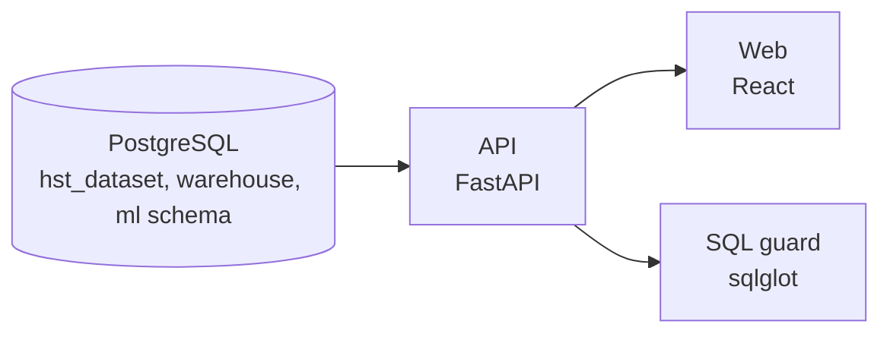

# hst-bi-poc

A self-built, read-only business intelligence dashboard for the [HST synthetic dataset](https://github.com/samsmon/hst-synthetic-dataset) (v0.3.0, 10.8 million ticket records). It has dashboards, a SQL console limited to `SELECT`, and pages for machine learning forecasts.

Status: phase P1 (foundation). The API validates SQL but does not yet query a database; the web app is a shell.

## Architecture



| Part | Path | Notes |
|---|---|---|
| API | `api/` | FastAPI. `app/sqlguard.py` validates console SQL. |
| Web | `web/` | React, Vite, TypeScript. |
| Semantic layer | `metrics/` | YAML measures and dimensions. Swapping the warehouse changes these files, not the UI. |
| SQL | `sql/` | Role and ML schema scripts. Reviewed before use, never run automatically. |
| Benchmark | `benchmark/` | Query set for comparing against Superset and Evidence (phase P3). |
| Design | `DESIGN.md` | UI rules and the visual language for forecasts. |

## Safety model

The database role is the real boundary: `bi_reader` can only `SELECT`, with timeouts set on the role. The SQL guard adds early, readable errors and returns SQL regenerated from the parsed tree, so the database runs exactly what was validated. It allows one `SELECT` (or `WITH ... SELECT`, or a plain `EXPLAIN`), and rejects writes, `SELECT INTO`, locking clauses, side-effect functions (`pg_*`, `lo_*`, `dblink*`, `set_config`, `nextval`, and similar), and schemas outside the allow list.

## Develop

API (Python 3.11 or newer):

```bash
cd api
python -m venv .venv
.venv/Scripts/python -m pip install -e ".[dev]"   # on Linux or macOS: .venv/bin/python
.venv/Scripts/python -m pytest -q
.venv/Scripts/python -m ruff check .
.venv/Scripts/python -m uvicorn app.main:app --reload
```

Web:

```bash
cd web
npm install
npm run dev      # proxies /api and /health to 127.0.0.1:8000
npm run lint
npm run build
```

## Deploy

`docker-compose.yml` runs the API and web containers and expects an existing PostgreSQL. Copy `.env.example` to `.env`, bind the web port to a private address, and never expose it to the public internet. Database credentials are supplied through the environment, not the repository.

## Roadmap

| Phase | Content |
|---|---|
| P1 | Foundation: repo, SQL guard with tests, API and web shells, CI (this state) |
| P2 | Read-only role and data checks on the server |
| P3 | Benchmarks against Superset and Evidence |
| P4 | Dashboards, semantic layer, SQL console execution |
| P4b | Forecast pages fed by the `ml` schema |
| P5 | Move from the wide table to the snowflake warehouse |
| P6 | Hardening and security audit |

Planning notes and decisions are kept in a separate notes repository.
