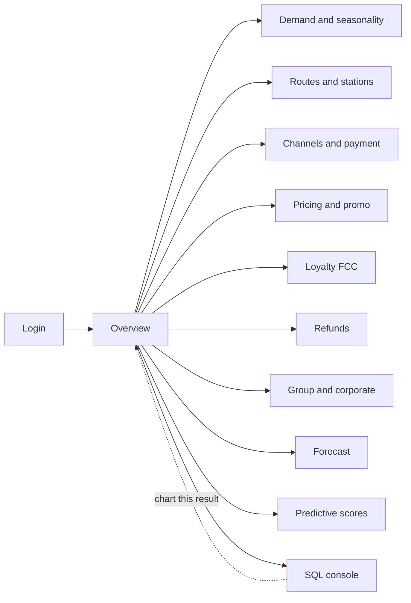

# Workflow

Screen flow, states, and wireframe hierarchy. Visual rules are in [DESIGN.md](DESIGN.md). The first Figma pass covers three screens: Overview, Forecast, and SQL console.

## Screen flow



Navigation is a persistent left list. Global filters (date range, season, route, channel, seat class) sit in the top bar and apply to every page except the SQL console. Roles: `viewer` sees dashboards, `analyst` also gets the SQL console and saved queries.

## Screen: Overview
Question: how are tickets and revenue doing for the selected period?

Hierarchy:
```
Frame 1440x900
  Navigation (208)
    Product name, page list, user and theme
  Main
    Top bar (56): page title, global filter bar, period label
    Content
      KPI row: Tickets, Gross revenue, Net revenue, Refund rate, Avg lead time
      Trend: net revenue by month, stacked bars by season type (brush on the time axis)
      Row of two: Channel mix (bars) and Route ranking (table, 5 rows, sortable)
      Footer line: source table, row count, query time, data freshness
```
Interactions: click a bar or a season in the legend to cross-filter the whole page; brush the trend to set the date range; clicking a table row filters by route.

## Screen: Forecast
Question: how many tickets do we expect over the next 1 to 2 months and the next year, and how good were past forecasts?

Hierarchy:
```
Frame 1440x900
  Navigation, Top bar (global filters, plus series picker)
  Content
    Banner (only when needed): demo run or stale run
    Controls: target, series, grain (day/week/month), horizon (28 days, 2 months, 1 year), run picker
    Main chart: actual solid, forecast dashed, interval band, forecast origin rule
    Row of two
      Model panel: model, version, trained until, forecast origin, interval level
      Accuracy panel: WAPE, MAE, MAPE for the run; mini backtest chart
    Capacity panel: forecast demand against scheduled seat capacity (summed per trip), shortfall marked when demand exceeds it
```
Interactions: switching grain or horizon redraws without a page change; the run picker can add a second run for side-by-side comparison.

## Screen: SQL console
Question: can I answer a question the dashboards do not cover, safely?

Hierarchy:
```
Frame 1440x900
  Navigation, Top bar (no global filters; shows role and connection)
  Content (split)
    Left: Schema browser (schemas, tables, columns with type and description)
    Right
      Editor: tabs for queries, toolbar (Run, Cancel, Format, Save), editor body
      Status line: duration, row count, truncated notice, rejected-by-guard message
      Results: virtualized grid, right-aligned numbers, Export CSV, Chart this result
    Right rail (collapsible): History and saved queries
```
Interactions: `Ctrl+Enter` runs the selection or the statement; `Esc` cancels; schema names insert at the cursor; a rejected statement shows the guard's reason beside the offending line.

## States to design for every data region
| State | Treatment |
|---|---|
| Loading | Skeleton at final size; no spinner over content; previous data stays visible while a refresh runs |
| Empty | One sentence saying why (filter too narrow, no run yet) and the one action that fixes it |
| Error | What failed in plain words, the request id, a retry control that retries |
| Truncated | Notice with the cap that was hit and an export action |
| Demo data | `caution` banner stays while any demo run is shown |
| Stale forecast | `caution` banner with the age of the latest run |
| Forbidden | Role message with who can grant access; no dead buttons |
| Guard rejection | Reason from the SQL guard, no stack trace |
| Timeout | States the timeout in seconds and suggests narrowing or aggregating |

## Responsive
1440 wide is the design size. At 1280 the navigation collapses to icons with labels on hover. At tablet width the filter bar wraps and the two-column rows stack. Phone is out of scope for the MVP.

## Review route
1. Check the three frames in Light, then Dark.
2. Run the checklist at the end of DESIGN.md on each frame.
3. Record changes here and in DESIGN.md before building the Svelte screens.
